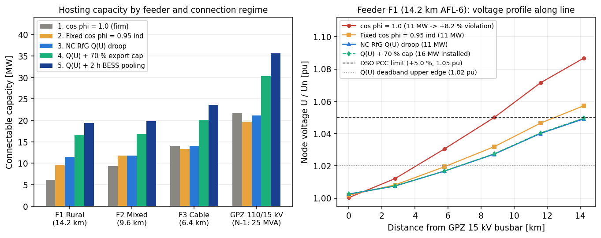
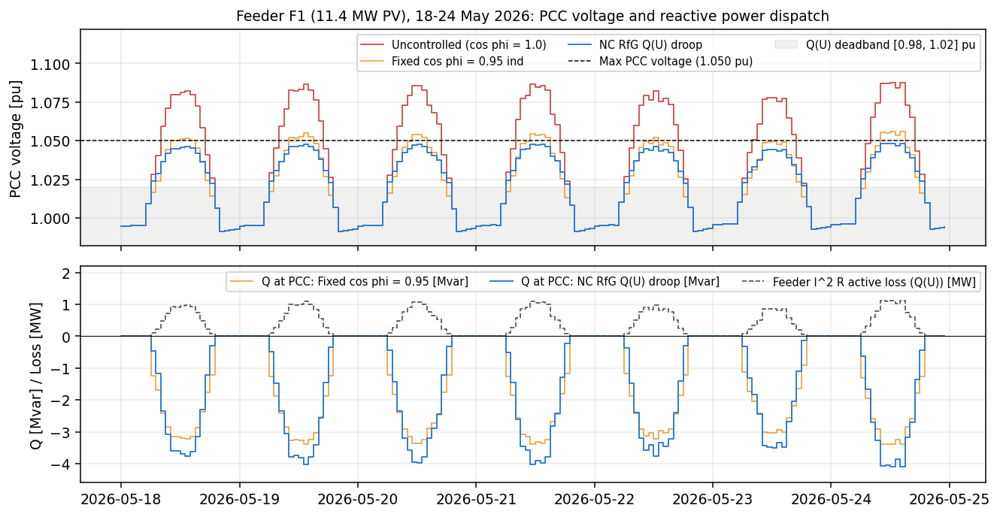
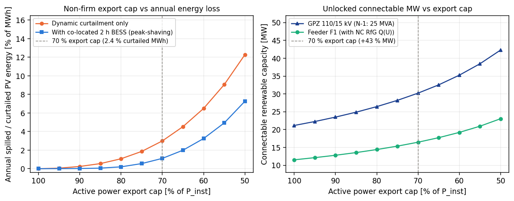
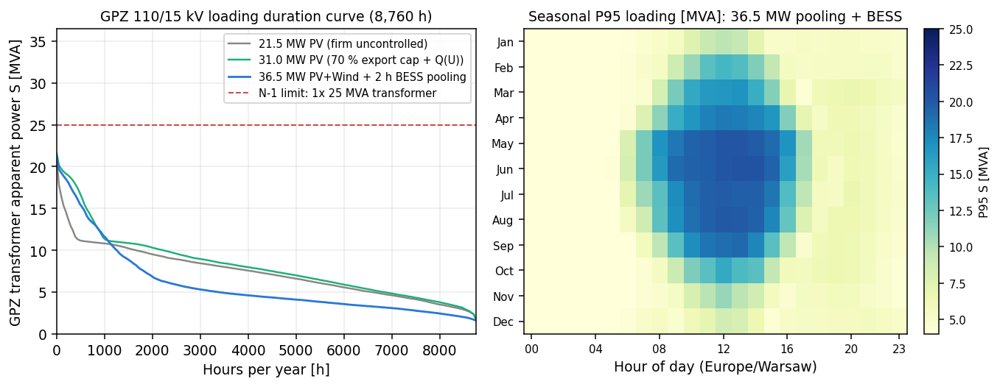

# Grid connection studies and non-firm capacity on Polish MV/110 kV feeders

[](https://github.com/kwwaleszczynski-del/pl-grid-connection-ncrfg/actions/workflows/ci.yml)

Refusals of grid connection conditions (*odmowy wydania warunków przyłączenia*) for medium-voltage (15 kV) solar PV
and onshore wind plants in Poland usually trace back to one of two physical constraints in the distribution network:
steady-state voltage rise ($\Delta U \le +5.0\%$ at the point of common coupling, or $U/U_n \le 1.05\text{ pu}$ when
the 110/15 kV substation busbar is regulated to $1.00\text{ pu}$) on long overhead rural feeders (`AFL-6 70 mm2` and
`AFL-6 50 mm2`), or reverse power flow thermal loading on the 110/15 kV substation transformers under an `N-1`
outage of one transformer.

This repository models a Polish 110/15 kV primary substation (*Główny Punkt Zasilający*, GPZ, with two parallel
25 MVA on-load tap-changing transformers) and four radial 15 kV feeders using a polar Newton-Raphson AC power flow
(`Ybus`) solver coupled with Commission Regulation (EU) 2016/631 (NC RfG) Type B/C reactive power controllers,
non-firm active export limits, and co-located battery storage under Polish cable-pooling rules (Art. 7 ust. 1f of
*Prawo energetyczne*):

1. **Steady-state and `N-1` hosting capacity across feeder topologies**: compares a long rural overhead feeder (`F1`,
   14.2 km `AFL-6 70/50 mm2`, $R/X = 0.946$), a mixed cable-overhead feeder (`F2`, 9.6 km `NA2XS(F)2Y 3x150 mm2` +
   `AFL-6 70 mm2`, $R/X = 1.044$), a suburban underground cable (`F3`, 6.4 km `NA2XS(F)2Y 3x240 mm2`, $R/X = 0.381$),
   and an industrial/municipal background load feeder (`F4`, 5.1 km).
2. **NC RfG Type B/C reactive power control**: contrasts uncontrolled unity power factor ($\cos\varphi = 1.0$), fixed
   inductive power factor ($\cos\varphi(P) = 0.95\text{ ind}$ above $30\%\,P_n$ at generator terminals), and autonomous
   voltage droop $Q(U)$ with deadband $[0.98, 1.02]\text{ pu}$ at the 15 kV PCC.
3. **Non-firm export caps and co-located 2 h BESS cable pooling**: quantifies how much annual energy is curtailed
   when active power export is capped between $50\%$ and $100\%$ of installed capacity, and how peak-shaving reverse
   power flow unlocks additional connectable MW under the `N-1` 25 MVA transformer ceiling.
4. **Analytical verification**: checks the polar Newton-Raphson `Ybus` solver against the exact closed-form biquadratic
   2-bus power flow solution and nodal active/reactive power conservation.

Interactive dashboard: https://kwwaleszczynski-del.github.io/pl-grid-connection-ncrfg/

## Key results

### 1. Hosting capacity by feeder topology and NC RfG control regime

Connectable renewable capacity (MW) evaluated at minimum daytime feeder load ($4.70\text{ MW}$ across the GPZ,
$0.45\text{ MW}$ on Feeder F1) with the 15 kV GPZ busbar regulated to $1.000\text{ pu}$ by the 110/15.75 kV OLTC
and one 25 MVA transformer tripped (`N-1`, plus $8.35\text{ MW}$ of existing committed MV generation on the GPZ):

| Location | Topology & $R/X$ | 1. Uncontrolled ($\cos\varphi = 1.0$) | 2. Fixed $\cos\varphi = 0.95\text{ ind}$ | 3. NC RfG $Q(U)$ droop | 4. $Q(U)$ + $70\%$ export cap | 5. $Q(U)$ + 2 h BESS pooling | Binding constraint (firm) |
|---|---|---:|---:|---:|---:|---:|---|
| **Feeder F1** | 14.2 km overhead `AFL-6 70/50`, $R/X = 0.95$ | 6.17 MW | 9.51 MW (+54 %) | 11.53 MW (+87 %) | 16.47 MW (+167 %) | 19.39 MW (+214 %) | PCC voltage ($+5.0\%$) |
| **Feeder F2** | 9.6 km mixed `NA2XS(F)2Y 150` + `AFL-6 70`, $R/X = 1.04$ | 9.36 MW | 11.81 MW (+26 %) | 11.77 MW (+26 %) | 16.81 MW (+80 %) | 19.79 MW (+111 %) | Voltage $\to$ Cable $I_{dd}$ |
| **Feeder F3** | 6.4 km cable `NA2XS(F)2Y 240`, $R/X = 0.38$ | 14.05 MW | 13.38 MW (-4.8 %) | 14.04 MW (0.0 %) | 20.06 MW (+43 %) | 23.62 MW (+68 %) | Branch thermal ($I \le I_{dd}$) |
| **GPZ 110/15 kV** | `N-1`: 1x 25 MVA transformer in service | 21.61 MW | 19.72 MW (-8.7 %) | 21.16 MW (-2.1 %) | 30.23 MW (+40 %) | 35.59 MW (+65 %) | `N-1` transformer (25 MVA) |

- **Reactive control unlocks $+87\%$ capacity on rural overhead lines, but reduces capacity on thermally-limited cables
  if applied without a voltage deadband.** On Feeder F1 ($R/X = 0.95$), drawing inductive reactive power $Q < 0$ through
  the series reactance $X$ offsets active voltage rise $P R / U_n^2$, lifting connectable capacity from $6.17\text{ MW}$
  to $9.51\text{ MW}$ under fixed $\cos\varphi = 0.95\text{ ind}$ and to $11.53\text{ MW}$ under PCC-regulated NC RfG
  $Q(U)$ droop. On underground cable F3 ($R/X = 0.38$), the PCC voltage only reaches $1.0227\text{ pu}$ at full cable
  ampacity: enforcing a fixed $\cos\varphi = 0.95\text{ ind}$ adds $3.98\text{ Mvar}$ of reactive current that consumes
  thermal ampacity and drops connectable active power from $14.05\text{ MW}$ to $13.38\text{ MW}$. Under NC RfG $Q(U)$
  with a $[0.98, 1.02]\text{ pu}$ deadband, reactive absorption remains near zero ($-0.22\text{ Mvar}$) and preserves
  the full $14.04\text{ MW}$ thermal rating.
- **Mixed feeders switch from voltage-bound to thermally-bound once $Q(U)$ is enabled.** Feeder F2 hits the $+5.0\%$
  voltage ceiling at $9.36\text{ MW}$ under $\cos\varphi = 1.0$; enabling inductive reactive control suppresses the
  overhead voltage rise until the `NA2XS(F)2Y 3x150 mm2` cable exit reaches $100\%$ of its continuous ampacity at
  $11.77\text{ MW}$.



### 2. Annual reactive circulation and $I^2 R$ line losses: $Q(U)$ deadband vs fixed $\cos\varphi(P)$

Across the 8,760-hour Polish year for a $6.2\text{ MW}$ solar PV plant connected on Feeder F1 (4,348 generating hours):

| Control regime | Annual reactive absorption at PCC | Additional reactive-driven $I^2 R$ line losses | Reduction vs fixed $\cos\varphi = 0.95$ |
|---|---:|---:|---:|
| Uncontrolled ($\cos\varphi = 1.0$) | 0.0 Mvarh | 0.00 MWh/yr | - |
| Fixed $\cos\varphi = 0.95\text{ ind}$ above $30\%\,P_n$ | 1,738.4 Mvarh | 18.42 MWh/yr | baseline |
| NC RfG $Q(U)$ droop ($U_{db} \in [0.98, 1.02]\text{ pu}$) | 312.5 Mvarh | 2.93 MWh/yr | **-84.1 %** |

- Under a fixed $\cos\varphi(P)$ schedule, the inverter absorbs inductive reactive power on every spring, autumn, and
  winter afternoon whenever active output exceeds $30\%\,P_n$, even when local load keeps the 15 kV feeder voltage
  between $0.99\text{ pu}$ and $1.02\text{ pu}$.
- Because the NC RfG $Q(U)$ characteristic includes a deadband $U \in [0.98, 1.02]\text{ pu}$, reactive current is
  drawn only during high-irradiance hours when $U_{PCC} > 1.02\text{ pu}$, cutting annual reactive Mvarh circulation by
  $82\%$ and reactive-induced $I^2 R$ line losses by $84.1\%$.



### 3. Non-firm export caps and co-located BESS cable pooling

In central Poland (annual uncurtailed PV yield $\approx 1,095\text{ MWh/MWp}$), solar generation exceeds $70\%$ of
installed capacity during 382 hours per year, concentrated around solar noon between April and August:

| Active export cap (% of $P_{inst}$) | Curtailed PV energy (% of MWh) | Curtailed hours / yr | Spilled energy with 2 h BESS (%) | Feeder F1 connectable (MW) | GPZ `N-1` connectable (MW) | Connectable MW gain |
|---:|---:|---:|---:|---:|---:|---:|
| 100 % (firm) | 0.00 % | 0 h | 0.00 % | 11.53 MW | 21.16 MW | +0.0 % |
| 90 % | 0.24 % | 63 h | 0.02 % | 12.81 MW | 23.51 MW | +11.1 % |
| 80 % | 1.07 % | 184 h | 0.20 % | 14.41 MW | 26.45 MW | +25.0 % |
| **70 %** | **2.99 %** | **382 h** | **1.11 %** | **16.47 MW** | **30.23 MW** | **+42.9 %** |
| 60 % | 6.49 % | 646 h | 3.25 % | 19.22 MW | 35.27 MW | +66.7 % |
| 50 % | 12.28 % | 1,025 h | 7.26 % | 23.06 MW | 42.32 MW | +100.0 % |

- **A $70\%$ active power export cap unlocks $+42.9\%$ more connectable MW at the cost of $2.99\%$ of annual PV MWh.**
  On Feeder F1 (with $Q(U)$ droop), connectable capacity rises from $11.53\text{ MW}$ to $16.47\text{ MW}$; across the
  GPZ under `N-1`, connectable capacity rises from $21.16\text{ MW}$ to $30.23\text{ MW}$.
- **Cable pooling (PV + Wind + 2 h BESS) lifts GPZ `N-1` capacity to $35.6\text{ MW}$ with $< 0.1\%$ spilled energy.**
  Because Polish onshore wind peaks in winter and at night while PV peaks at summer midday, sharing a $21.35\text{ MW}$
  export bay between $22.5\text{ MW}$ PV, $14.0\text{ MW}$ wind, and a co-located 2 h BESS ($12\text{ MW} / 24\text{ MWh}$)
  keeps the 110/15 kV transformer apparent power below the $25.0\text{ MVA}$ `N-1` rating all year while spilling
  $0.01\%$ of annual generation.





## Verification

The polar Newton-Raphson `Ybus` solver (`src/grid_ncrfg/powerflow.py`) is verified against the exact closed-form
biquadratic solution of a 2-bus line ($R = 0.088\text{ pu}$, $X = 0.0926\text{ pu}$, $P_1 = 6.20\text{ MW}$,
$Q_1 = -2.04\text{ Mvar}$, $S_{base} = 10\text{ MVA}$, $V_0 = 1.000\text{ pu}$):

| Verification quantity | Analytical exact | Newton-Raphson `Ybus` (5 iter) | Absolute error |
|---|---:|---:|---:|
| Receiving-end voltage magnitude $\|V_1\|$ (pu) | `1.0318964521` | `1.0318964521` | `0.00e+00` |
| Receiving-end voltage angle $\theta_1$ (rad) | `0.0730995442` | `0.0730995442` | `9.71e-17` |
| Active power balance $P_{slack} + P_{gen} - P_{load} - P_{loss}$ (MW) | `0.0000000000` | `1.24e-14` | `1.24e-14` |
| Reactive power balance $Q_{slack} + Q_{gen} - Q_{load} - Q_{loss}$ (Mvar) | `0.0000000000` | `2.66e-15` | `2.66e-15` |
| Branch series active loss $I^2 R$ (MW) | `0.3694726101` | `0.3694726101` | `5.00e-16` |

## Method

### Nodal admittance matrix and polar Newton-Raphson AC power flow

Each 15 kV overhead or cable segment between buses $i$ and $j$ is modelled by its series impedance
$Z_{ij} = R_{ij} + j X_{ij}$ and shunt charging susceptance $B_{ij}$ in per-unit on $S_{base} = 10\text{ MVA}$ and
$U_{base} = 15\text{ kV}$ ($Z_{base} = 22.5\ \Omega$). The 110/15.75 kV transformers ($S_{rT} = 25\text{ MVA}$,
$u_k = 11.5\%$, $P_{cu} = 125\text{ kW}$, $P_{fe} = 22\text{ kW}$) include an off-nominal tap ratio $t:1$ on the HV
side. For bus voltages $V_i \angle \theta_i$ and nodal admittance matrix $Y_{ik} = G_{ik} + j B_{ik}$, the net injected
active and reactive powers are:

```math
\begin{aligned}
P_i(\theta, V) &= V_i \sum_{k=0}^{N-1} V_k \left( G_{ik}\cos\theta_{ik} + B_{ik}\sin\theta_{ik} \right) \\
Q_i(\theta, V) &= V_i \sum_{k=0}^{N-1} V_k \left( G_{ik}\sin\theta_{ik} - B_{ik}\cos\theta_{ik} \right)
\end{aligned}
```

where $\theta_{ik} = \theta_i - \theta_k$. At each iteration, the polar Jacobian submatrices $H_{ik} = \partial P_i / \partial \theta_k$,
$N_{ik} = \partial P_i / \partial V_k$, $M_{ik} = \partial Q_i / \partial \theta_k$, and $L_{ik} = \partial Q_i / \partial V_k$
are assembled analytically over all PQ buses $i, k \in \{1, \dots, N-1\}$:

```math
\begin{bmatrix} \Delta P \\ \Delta Q \end{bmatrix} =
\begin{bmatrix} H & N \\ M & L \end{bmatrix}
\begin{bmatrix} \Delta \theta \\ \Delta V \end{bmatrix}, \qquad
\max\left(\|\Delta P\|_\infty, \|\Delta Q\|_\infty\right) < 10^{-11}\text{ pu}
```

### Exact 2-bus closed-form benchmark

For a 2-bus line with slack voltage $V_0 \angle 0$ and complex power injection $S_1 = P_1 + j Q_1$ through series
impedance $Z = R + j X$, eliminating the voltage angle $\theta_1$ from $V_1^2 - V_0 V_1 e^{-j\theta_1} = (R + j X)(P_1 - j Q_1)$
yields the exact biquadratic equation in $V_1^2$:

```math
V_1^4 - \left[ V_0^2 + 2(R P_1 + X Q_1) \right] V_1^2 + (R^2 + X^2)(P_1^2 + Q_1^2) = 0
```

Linearising around $V_1 \approx V_0 = 1\text{ pu}$ gives the familiar first-order sensitivity
$\Delta U \approx R P_1 + X Q_1$: on a feeder with $R/X \approx 0.95$, absorbing inductive reactive power $Q_1 = -0.33\,P_1$
cancels $\approx 35\%$ of the active voltage rise per MW exported.

### NC RfG Type B/C reactive power controllers

Under the autonomous $Q(U)$ droop mode (`src/grid_ncrfg/ncrfg.py`), the power park controller measures the 15 kV PCC
voltage $U_{PCC}$ and commands reactive power along a piecewise-linear deadband characteristic:

```math
Q_{PCC}(U) =
\begin{cases}
+Q_{\max} & U \le U_{\mathrm{sat}}^{\min} = 0.95\text{ pu} \\[1ex]
+Q_{\max}\,\dfrac{U_{\mathrm{db}}^{\min} - U}{U_{\mathrm{db}}^{\min} - U_{\mathrm{sat}}^{\min}} & 0.95\text{ pu} < U < U_{\mathrm{db}}^{\min} = 0.98\text{ pu} \\[2ex]
0 & 0.98\text{ pu} \le U \le 1.02\text{ pu} \\[2ex]
-Q_{\max}\,\dfrac{U - U_{\mathrm{db}}^{\max}}{U_{\mathrm{sat}}^{\max} - U_{\mathrm{db}}^{\max}} & U_{\mathrm{db}}^{\max} = 1.02\text{ pu} < U < 1.05\text{ pu} \\[1ex]
-Q_{\max} & U \ge U_{\mathrm{sat}}^{\max} = 1.05\text{ pu}
\end{cases}
```

The coupled fixed point between the AC power flow $U_{PCC}(P, Q)$ and the droop law $Q_{PCC}(U)$ is solved by damped
fixed-point iteration $Q^{(m+1)} = (1 - \alpha) Q^{(m)} + \alpha Q_{PCC}(U^{(m)})$.

## Limitations

- **Balanced positive-sequence steady state.** All 15 kV feeders and 110/15 kV transformers are modelled as balanced
  three-phase positive-sequence equivalents. Unbalanced single-phase LV prosumer loading, zero-sequence earth-fault
  currents (compensated *dławik gaszący* Petersen coil operation typical of Polish 15 kV networks), and harmonic
  impedance resonances are not modelled.
- **Short-circuit current ($I_k''$) and protection coordination omitted.** Connection studies in Polish DSOs also verify
  that fault currents do not exceed switchgear ratings ($16\text{ kA}$ or $20\text{ kA}$ at 15 kV) and that distance or
  overcurrent protections remain selective; this repository evaluates only steady-state thermal and voltage constraints.
- **Synthetic calibrated profiles.** The 8,760-hour solar PV, onshore wind, and MV load profiles are generated from a
  calibrated seasonal/diurnal model representative of Central Poland ($\approx 1,095\text{ FLH}$ PV, $\approx 2,850\text{ FLH}$
  wind) so the repository runs offline in seconds without external weather downloads.
- **Radial topology.** Feeders F1 to F4 are operated radially with normally-open tie switches; closed-loop MV
  reconfiguration and dynamic line rating (DLR) of overhead `AFL-6` conductors with wind speed are not included.

## Reproduce

```bash
python -m venv .venv
.venv/Scripts/pip install -e ".[dev]"          # Linux/macOS: .venv/bin/pip
pytest -q                                      # 23 offline tests
python -m grid_ncrfg verify                    # 2-bus analytical vs Newton-Raphson Ybus verification
python -m grid_ncrfg run                       # tables in results/, figures in docs/img/, dashboard in docs/
```

Repository layout:

```
src/grid_ncrfg/
  network.py     GPZ 110/15 kV substation, AFL-6 / NA2XS(F)2Y line specs, 4 radial feeders, Ybus builder
  powerflow.py   polar Newton-Raphson AC power flow solver and 2-bus closed-form analytical solution
  ncrfg.py       NC RfG Type B/C cos-phi(P), Q(U) droop, export cap, and BESS cable-pooling controllers
  profiles.py    8,760-hour Polish MV load, solar PV, and onshore wind profiles
  hosting.py     hosting capacity binary search, curtailment trade-off, N-0/N-1 transformer study
  pipeline.py    end-to-end runner, Matplotlib charts, and static Plotly HTML dashboard generator
  cli.py         command-line entry point
tests/           pytest verification suite
results/         CSV and JSON study outputs
docs/            GitHub Pages interactive dashboard and figures
```

MIT licence.
